<div align="center">

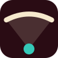

# نما · سینمایی که از صندلی تو دیده می‌شود

**قبل از رزرو، روی صندلی بنشین و پرده را از همان‌جا ببین.**


[نمایش تصویری](#gallery) · [نمای صندلی](#pov) · [سالن‌ها](#halls) · [قیمت‌گذاری](#pricing) · [امکانات](#features) · [شروع سریع](#getting-started) · [معماری](#architecture)

[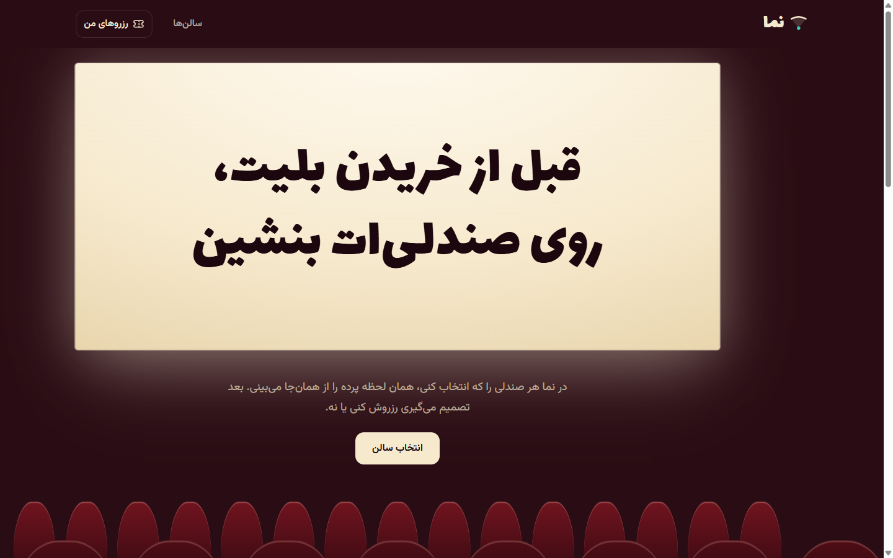](docs/screenshots/home.png)

</div>

نما یک سایت رزرو بلیت سینما با رابط فارسی و راست‌چین است. سه سالن دارد؛ در هر سالن سانس را انتخاب می‌کنید، روی یک صندلی می‌زنید و دوربین از نقشهٔ صندلی‌ها وارد سالن سه‌بعدی می‌شود، روی همان صندلی می‌نشیند و پرده را از همان زاویه نشان می‌دهد. اگر دیدش را دوست نداشتید، برمی‌گردید و صندلی دیگری را امتحان می‌کنید. هر صندلی با فاصله و زاویهٔ دیدش قیمت‌گذاری شده است.

> این پروژه یک دموی فرانت‌اند است. فیلم‌ها و سالن‌ها خیالی‌اند، تصویر روی پرده با کد نقاشی می‌شود، صندلی‌های پر برای هر سانس به‌صورت خودکار ساخته می‌شوند و رزروها فقط در مرورگر خودتان ذخیره می‌شوند. صفحهٔ پرداخت ندارد.

| سالن | نمای صندلی | قیمت | رزرو |
| :---: | :---: | :---: | :---: |
| **۳ سالن** با پرده و چیدمان متفاوت | از هر یک از **۲۹۶ صندلی** نمای واقعی پرده | **۴ سطح** قیمت از روی زاویهٔ دید، ۲۰۰ تا ۷۵۰ هزار تومان | فهرست رزروها، لغو و تعداد صندلی خالی هر سانس |

<a id="gallery"></a>
## نمایش تصویری پروژه

برای دیدن جزئیات روی تصویرها کلیک کنید.

### سالن‌ها؛ هر سالن یک پرده و یک فیلم

[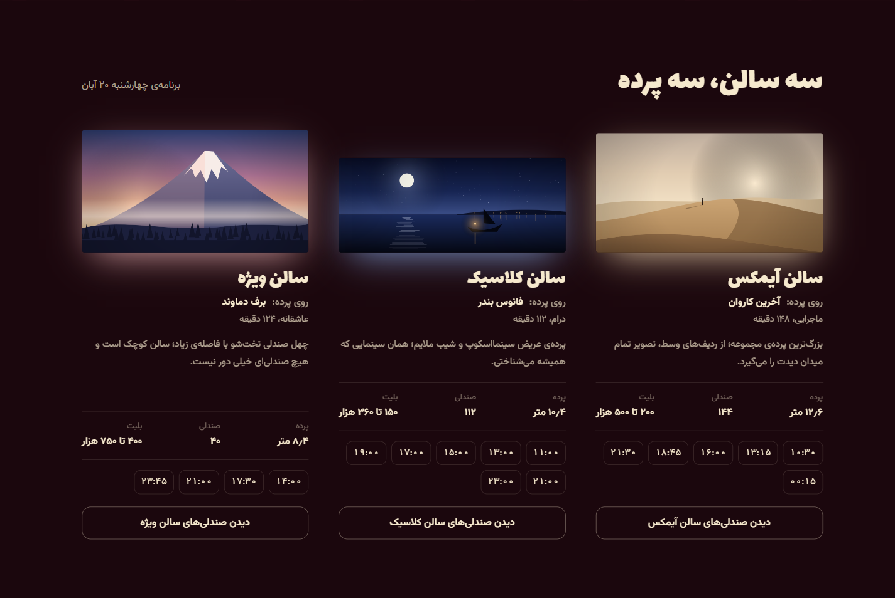](docs/screenshots/halls.png)

هر کارت پردهٔ همان سالن را با نسبت واقعی‌اش نشان می‌دهد: پردهٔ ۱۲٫۶ متری آیمکس، پردهٔ عریض کلاسیک و پردهٔ کوچک‌تر سالن ویژه. ساعت سانس‌ها لینک مستقیم به همان سانس در نقشهٔ صندلی‌ها هستند.

### نقشهٔ صندلی‌ها؛ رنگ هر صندلی یعنی قیمتش

[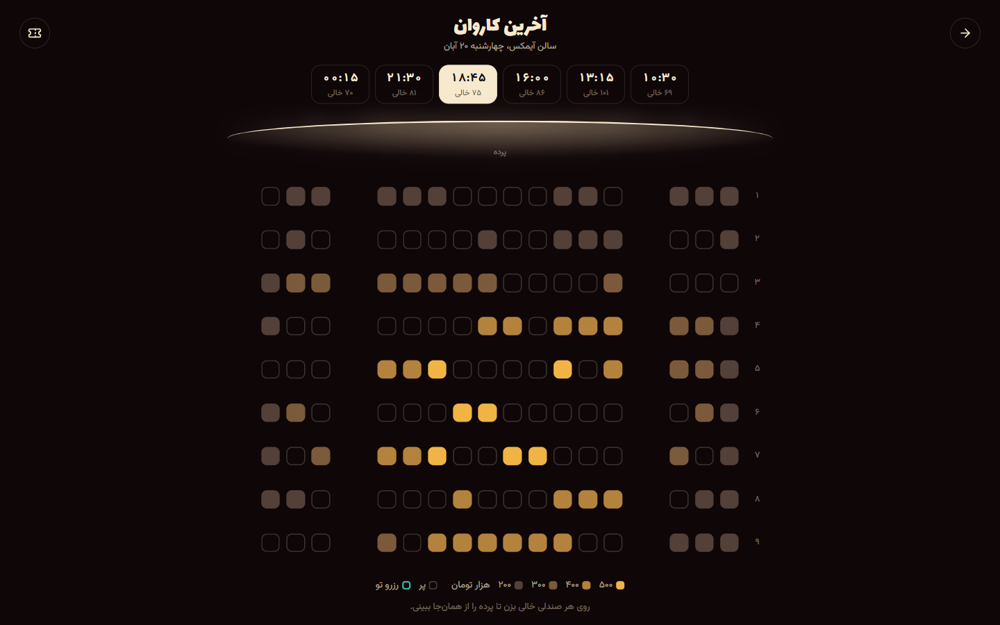](docs/screenshots/map.png)

طلایی روشن بهترین دید و گران‌ترین قیمت است و قهوه‌ای تیره ارزان‌ترین. صندلی‌های پر فقط خط دورشان پیداست و صندلی‌های رزروشدهٔ خودتان فیروزه‌ای است. نوار بالا سانس‌ها را نشان می‌دهد و در موبایل با اسکرول افقی جابه‌جا می‌شود؛ زیر هر ساعت تعداد صندلی خالی همان سانس نوشته شده است.

<a id="pov"></a>
### نمای صندلی؛ از نقشه تا نشستن

نقشهٔ دوبعدی و سالن سه‌بعدی از یک مختصات می‌آیند و دوربین نخست درست روی نقشه قرار می‌گیرد. با زدن روی صندلی نقشه محو می‌شود و همان صحنه‌ای که زیرش بود پیدا می‌شود؛ بعد دوربین پایین می‌آید، روی صندلی می‌نشیند و به پرده نگاه می‌کند.

| وسط پرواز | نشسته روی صندلی طلایی |
|---|---|
| [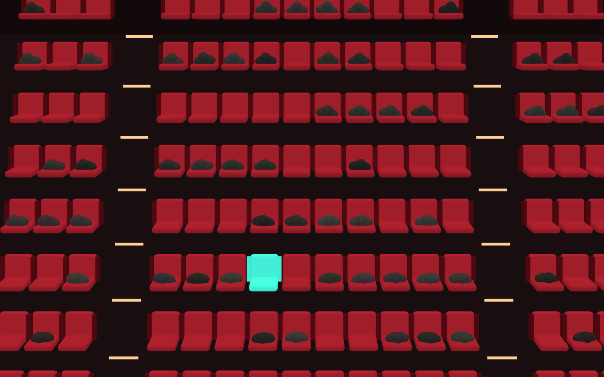](docs/screenshots/flight.png) | [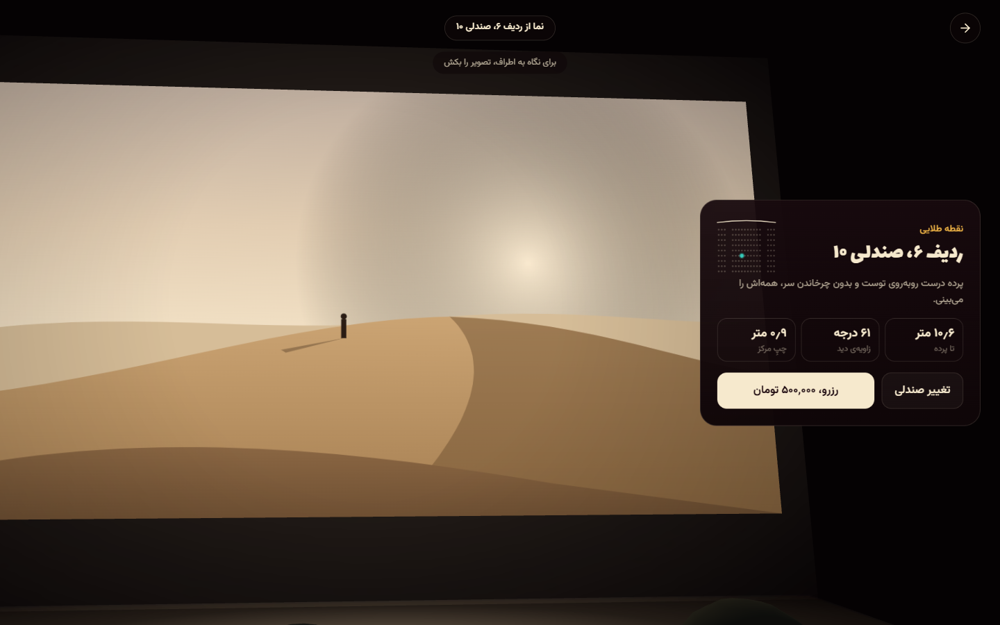](docs/screenshots/seat-center.png) |
| صندلی انتخاب‌شده فیروزه‌ای و روشن است | کارت کناری فاصله، زاویه و قیمت را می‌گوید |

از صندلی کناری، پرده اریب دیده می‌شود و کارت همین را می‌گوید. تصویر را می‌شود کشید تا دور و بر سالن دیده شود.

| صندلی کناری، آیمکس | سالن ویژه | سالن کلاسیک |
|---|---|---|
| [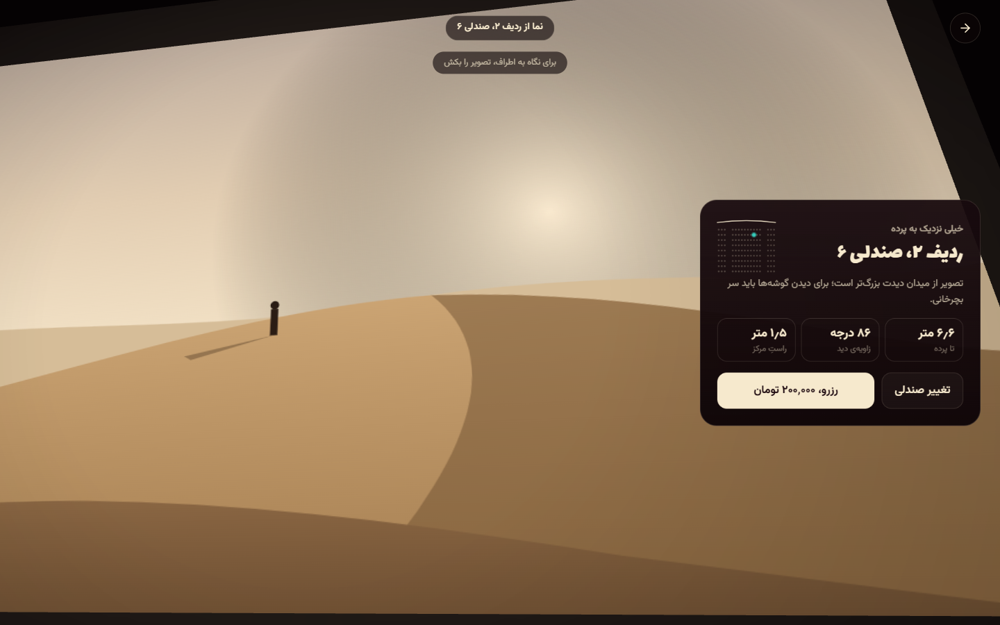](docs/screenshots/seat-side.png) | [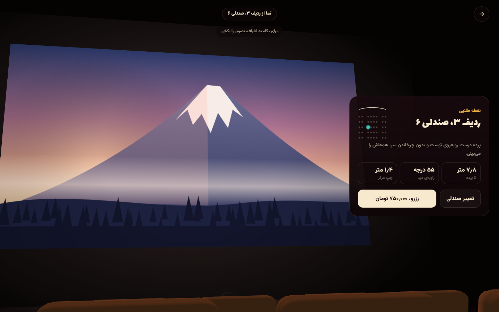](docs/screenshots/seat-vip.png) | [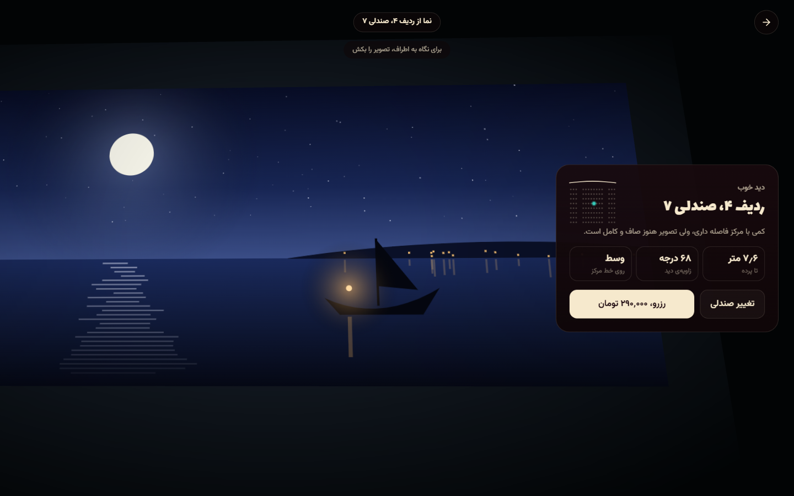](docs/screenshots/seat-classic.png) |

### رزرو و فهرست رزروها

| پس از رزرو | رزروهای من |
|---|---|
| [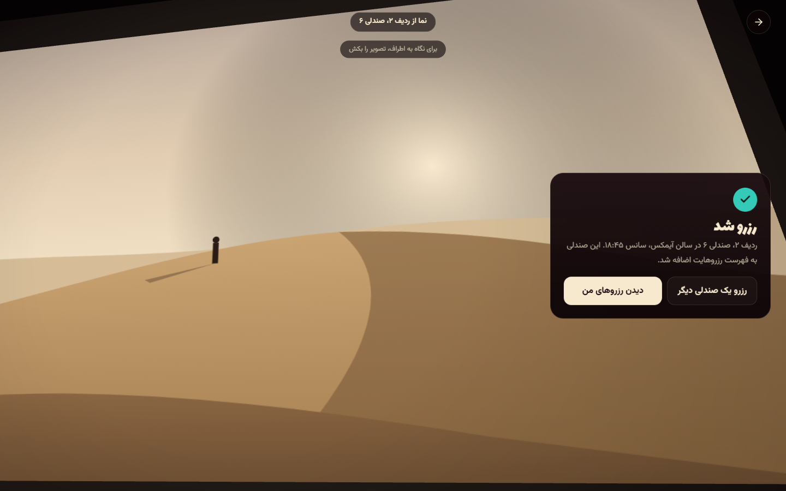](docs/screenshots/booked.png) | [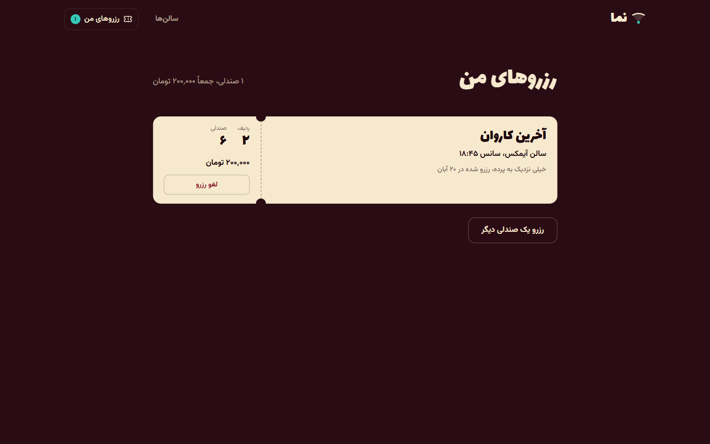](docs/screenshots/reservations.png) |
| می‌توانید صندلی دیگری هم رزرو کنید | هر رزرو به شکل بلیت نمایش داده می‌شود و قابل لغو است |

### تجربهٔ موبایل

<details>
<summary>دیدن صفحهٔ اصلی، نقشه و نمای صندلی در موبایل</summary>
<br />
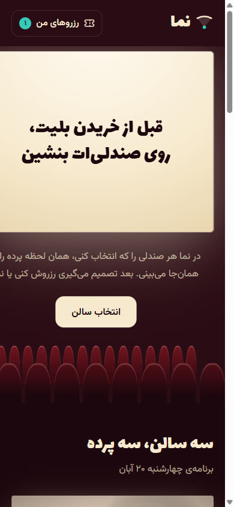
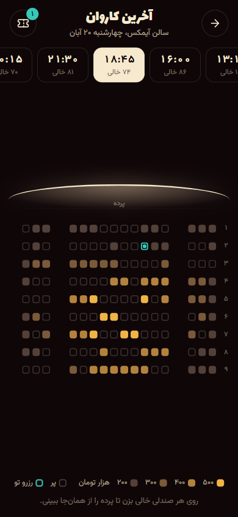
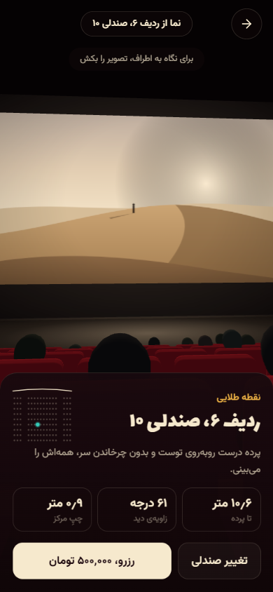
</details>

در موبایل پنل رزرو از پایین بالا می‌آید و تصویر آن‌قدر بالا می‌رود که پرده زیر پنل نماند. در صفحه‌های عریض، پنل کارتی کنار تصویر است و تصویر به سمت دیگر می‌رود.

<a id="halls"></a>
## سالن‌ها

| | آیمکس | کلاسیک | ویژه |
|---|---|---|---|
| فیلم نمایشی | آخرین کاروان | فانوس بندر | برف دماوند |
| صندلی | ۱۴۴ در ۹ ردیف | ۱۱۲ در ۸ ردیف | ۴۰ در ۵ ردیف |
| عرض پرده | ۱۲٫۶ متر | ۱۰٫۴ متر | ۸٫۴ متر |
| صدا | ۱۲ کاناله | دالبی ۷٫۱ | دالبی اتموس |
| سانس‌ها | ۶ | ۷ | ۴ |
| بلیت | ۲۰۰ تا ۵۰۰ هزار | ۱۵۰ تا ۳۶۰ هزار | ۴۰۰ تا ۷۵۰ هزار |

هر سالن هندسهٔ خودش را دارد: فاصلهٔ ردیف‌ها، شیب کف، اندازهٔ صندلی، اندازه و ارتفاع پرده و رنگ دیوار و پارچه. همهٔ این‌ها در [src/data/halls.ts](src/data/halls.ts) نوشته شده‌اند و نقشه، سالن سه‌بعدی و قیمت‌ها از همان‌جا ساخته می‌شوند.

<a id="pricing"></a>
## قیمت‌گذاری از روی زاویهٔ دید

قیمت هر صندلی از دیدش به پرده حساب می‌شود، نه از شمارهٔ ردیفش. برای هر صندلی زاویه‌ای که پرده در چشم می‌سازد محاسبه می‌شود و با زاویهٔ مطلوب همان سالن مقایسه می‌شود؛ جلوتر از آن بیشتر جریمه دارد تا دورتر. فاصله از خط مرکز هم جداگانه کم می‌کند. نتیجه یک امتیاز بین صفر و یک است که به چهار سطح تقسیم می‌شود.

| سطح | معنا | آیمکس | کلاسیک | ویژه |
|---|---|---:|---:|---:|
| ۴ | نقطهٔ طلایی | ۵۰۰٬۰۰۰ | ۳۶۰٬۰۰۰ | ۷۵۰٬۰۰۰ |
| ۳ | دید خوب | ۴۰۰٬۰۰۰ | ۲۹۰٬۰۰۰ | ۶۰۰٬۰۰۰ |
| ۲ | دید معمولی | ۳۰۰٬۰۰۰ | ۲۲۰٬۰۰۰ | ۵۰۰٬۰۰۰ |
| ۱ | جلو، ته سالن و کناره‌ها | ۲۰۰٬۰۰۰ | ۱۵۰٬۰۰۰ | ۴۰۰٬۰۰۰ |

قیمت‌ها به تومان‌اند. کارت صندلی هم یکی از پنج توضیح را می‌دهد: نقطهٔ طلایی، دید خوب، خیلی نزدیک به پرده، تصویر کامل از دور یا دید کناری.

<a id="features"></a>
## امکانات اصلی

| بخش | امکانات |
|---|---|
| صفحهٔ اصلی | تیتر روی پردهٔ سینما با ردیف صندلی زیرش، سه سالن، توضیح مراحل و جدول قیمت |
| سانس‌ها | نوار سانس با تعداد صندلی خالی، سانس پیش‌فرض بر اساس ساعت حال، لینک مستقیم به هر سانس |
| صندلی‌های پر | برای هر سالن و ساعت یک الگوی ثابت ساخته می‌شود؛ صندلی‌های بهتر زودتر پر می‌شوند و کنار هم می‌نشینند |
| نقشه | چینش صندلی‌ها با مختصات واقعی سالن، راهروها، شمارهٔ ردیف، راهنمای رنگ و نکتهٔ شناور هنگام نگه‌داشتن ماوس |
| پرواز دوربین | یک حرکت پیوسته از نقشه تا صندلی و برگشت با دکمهٔ بازگشت یا کلید Escape |
| سالن سه‌بعدی | صندلی‌ها، شیب کف، نورهای پله، چراغ‌های دیوار، نور پرده روی دیوار و کف و تماشاگرهای نشسته |
| نگاه به اطراف | با کشیدن تصویر تا حدی می‌شود سر را چرخاند |
| رزرو | رزرو یک صندلی، جلوگیری از رزرو دوباره، فهرست رزروها، لغو و مجموع قیمت |
| ذخیره | رزروها در مرورگر می‌مانند و بین تب‌ها همگام می‌شوند |
| دسترسی | صندلی‌ها دکمهٔ واقعی با برچسب فارسی‌اند، فوکوس دیده می‌شود و با کاهش حرکت، پرواز بلافاصله انجام می‌شود |
| بدون WebGL | اگر مرورگر WebGL نداشته باشد، نقشه، قیمت و رزرو همچنان کار می‌کنند |

<a id="getting-started"></a>
## شروع سریع

پیش‌نیاز: **Node.js 22 یا بالاتر**.

```bash
git clone https://github.com/hamidshaikhy/nama.git
cd nama
npm install
npm run dev
```

سایت روی `http://localhost:5173` باز می‌شود و از شبکهٔ محلی هم برای تست روی گوشی در دسترس است.

| دستور | کار |
|---|---|
| `npm run dev` | اجرای سرور توسعه |
| `npm run build` | بررسی تایپ‌ها و ساخت نسخهٔ نهایی در `dist/` |
| `npm run preview` | اجرای نسخهٔ ساخته‌شده روی `http://localhost:4173` |

برای انتشار در Vercel کافی است پروژه را وصل کنید؛ فایل [vercel.json](vercel.json) همهٔ مسیرها را به `index.html` می‌فرستد.

<a id="architecture"></a>
## معماری و فناوری‌ها

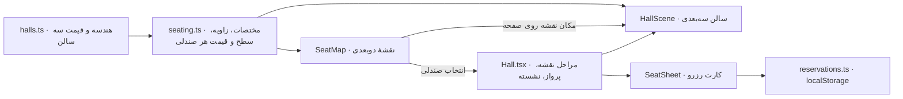

| لایه | فناوری |
|---|---|
| رابط | React 19، React Router 7، TypeScript |
| ساخت | Vite 6 |
| سه‌بعدی | Three.js با WebGL؛ صندلی‌ها و تماشاگرها با InstancedMesh |
| تصویر پرده | Canvas2D؛ فایل تصویری دانلود نمی‌شود |
| آیکون و فونت | lucide-react، لاله‌زار برای تیترها، وزیرمتن برای متن |
| ذخیره | localStorage با useSyncExternalStore |
| استایل | CSS ساده با متغیرها، بدون کتابخانهٔ UI |

### چرا سبک می‌ماند

- **یک بار رسم برای همهٔ صندلی‌ها:** تمام صندلی‌ها یک هندسهٔ مشترک‌اند و با یک درخواست رسم می‌شوند؛ همین برای تماشاگرها و چراغ‌های پله هم درست است.
- **رندر فقط در صورت نیاز:** حلقهٔ رندر فقط هنگام پرواز، کشیدن تصویر و تغییر اندازه فریم می‌سازد و بعد خودش را متوقف می‌کند.
- **شیدرها از قبل کامپایل می‌شوند:** صحنه هنگام نمایش نقشه ساخته و کامپایل می‌شود، پس اولین پرواز روی فریم اول گیر نمی‌کند.
- **Three.js در بستهٔ جدا:** فقط با صفحهٔ سالن بارگذاری می‌شود و صفحهٔ اصلی سبک می‌ماند. نسخهٔ gzip بستهٔ اصلی حدود ۹۲ و بستهٔ سالن حدود ۱۲۹ کیلوبایت است. بستهٔ سالن پس از بیکاری صفحهٔ اصلی از قبل گرفته می‌شود.
- **ابعاد یکسان روی هر صفحه:** زاویهٔ دید دوربین از روی نسبت صفحه تنظیم می‌شود تا پردهٔ سالن در موبایل عمودی هم به همان پهنا دیده شود.

```text
src/
  data/halls.ts          هندسه، فیلم، سانس‌ها و قیمت هر سالن
  lib/seating.ts         ساخت صندلی‌ها، امتیاز دید، سطح قیمت و صندلی‌های پر
  lib/reservations.ts    فهرست رزروها در localStorage
  lib/filmArt.ts         نقاشی سه پردهٔ نمایشی با Canvas
  lib/format.ts          اعداد، تاریخ و تومان به فارسی
  three/HallScene.ts     سالن، دوربین، پرواز و نگاه به اطراف
  components/            نقشه، کارت صندلی، لوگو و سربرگ
  pages/                 صفحهٔ اصلی، سالن و رزروها
  styles/                استایل عمومی و استایل صفحهٔ سالن
docs/
  brand/                 نشان نما
  screenshots/           تصاویر این README
```

## ساختهٔ

[حمید شیخی](https://hamidshaikhy.vercel.app/) · [GitHub](https://github.com/hamidshaikhy)

ایدهٔ تجربهٔ «دیدن پرده از صندلی» از یک ویدیوی دمو الهام گرفته شده است؛ تصویر، کد و طراحی این پروژه از نو نوشته شده‌اند.
